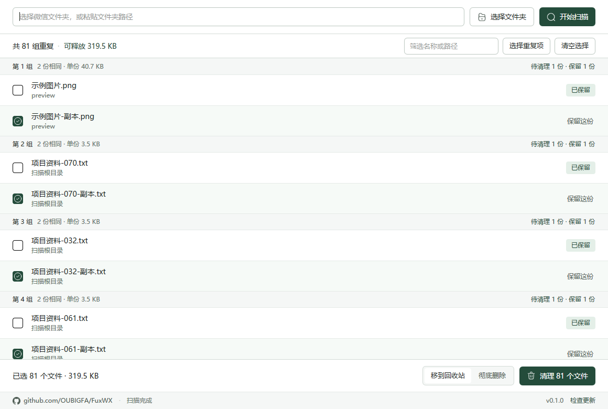
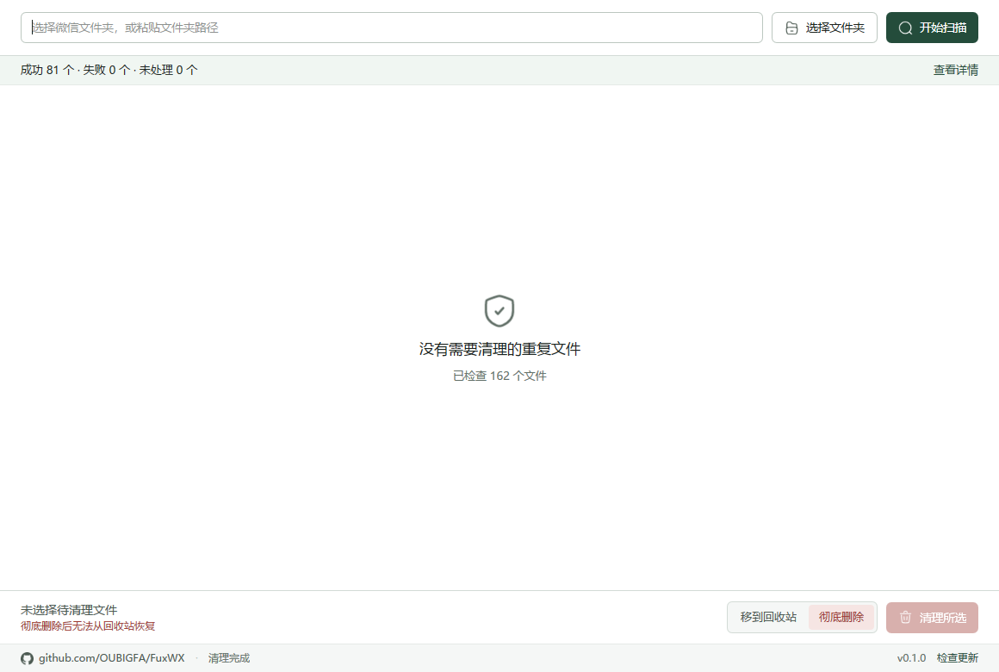

# FuxWX

**Find duplicate files in your WeChat folders and clean them up after you check them.**

[简体中文](README.md) · English

---

## Preview

  

[Scan results](assets/screenshots/FuxWX-main.png) · [Cleanup complete](assets/screenshots/FuxWX-complete.png)

## About FuxWX

FuxWX is a Windows app that cleans up duplicate files. WeChat often saves the same image or document more than once. FuxWX finds these copies. You check each group, choose the copy to keep, and then confirm the cleanup. Files are processed only on your computer and are never uploaded.

The app interface is in Simplified Chinese. This guide gives each button's Chinese label with an English description.

## What you can do

- **Find duplicate files.** Scan a folder you choose and compare files by their complete contents. Files that have the same size but different contents are not treated as duplicates.
- **Check each group.** Each group lists the file names, locations, and sizes. Click a file name to see its details. Images can be previewed directly.
- **Choose the copy to keep.** After you click 选择重复项 (Select duplicates), FuxWX keeps the copy with the shortest path in each group. Click 保留这份 (Keep this copy) to keep a different file instead. At least one file always stays in each group.
- **Clean up safely.** Files go to the Recycle Bin by default, so you can restore them. Permanent deletion must be chosen and confirmed separately.
- **Stop at any time.** Scanning and cleanup run in the background, and the window stays responsive. When you stop a task, FuxWX reports how many files were processed, failed, and left untouched.
- **Filter the results.** Filter duplicates by name or path, or open a file's location.
- **Check for a new version.** Click 检查更新 (Check for updates) at the bottom to look for a new stable release.

## Download and get started

### Install FuxWX

1. Open the [FuxWX releases page](https://github.com/OUBIGFA/FuxWX/releases).
2. Download `FuxWX-0.1.0.exe`.
3. Open the downloaded file and follow the instructions on screen.

The current version is 0.1.0. It supports 64-bit Windows 10 (version 1809 or later) and Windows 11.

The installer installs FuxWX for the current user. You do not need administrator rights. The installer uses your Windows display language. If no translation is available, it uses English. After installation, open FuxWX from the Start menu.

To uninstall FuxWX, open Settings, select Apps, select Installed apps, and then select FuxWX.

### Clean up duplicate files

1. Open FuxWX. Click 选择文件夹 (Choose folder) and select the WeChat folder to check. You can also paste a folder path.
2. Click 开始扫描 (Start scan).
3. Check the results and click 选择重复项 (Select duplicates).
4. Choose 移到回收站 (Move to Recycle Bin) or 彻底删除 (Delete permanently), and then click the cleanup button.
5. Check the number and size of the files in the confirmation window, and then confirm.

## Optional tasks

- **Keep a different file.** Click 保留这份 (Keep this copy) on the file you want to keep. The other files in that group are selected for cleanup.
- **Clear the selection.** Click 清空选择 (Clear selection), or clear the check boxes one by one.
- **See file details.** Click a file name to see its size, modified time, and location on the right. Click 打开文件位置 (Open file location) to show it in File Explorer.
- **Stop a task.** While scanning or cleaning up, click 停止任务 (Stop task) at the bottom. Completed actions are not undone.
- **See failed items.** After a cleanup, click 查看详情 (View details) to see which files were not processed and why.
- **Check for updates.** Click 检查更新 (Check for updates) at the bottom. If a new version is available, click 查看新版本 (View new version) to open its download page. FuxWX does not download or install updates by itself.

## Notes

- The installer for this version is not digitally signed. The first time you run it, Windows may show "Windows protected your PC". Click More info, and then click Run anyway.
- Permanently deleted files skip the Recycle Bin and cannot be restored from it. Back up important files first.
- Files in the Recycle Bin still use disk space until you empty the Recycle Bin.
- Files that are changed, moved, or unavailable after the scan are kept and reported in the results. If moving a file to the Recycle Bin fails, FuxWX does not delete it permanently instead.
- Image previews are limited to 16 MB. For other files, open their location to view them.

## Sources and license

FuxWX is open-source software under the [MIT](LICENSE) license. The source code is in the [GitHub repository](https://github.com/OUBIGFA/FuxWX). FuxWX is based on [WxCleaner](https://github.com/yqxie1991/WxCleaner) and keeps the original author's copyright. The interface is built with [nsh](https://github.com/longbridge/nsh). Icons are [Solar Linear](https://github.com/saoudi-h/solar-icons), designed by [480 Design](https://www.figma.com/community/file/1166831539721848736) and used with attribution under CC BY 4.0.

[MIT license](LICENSE) · [Third-party components](third_party/README.md)
