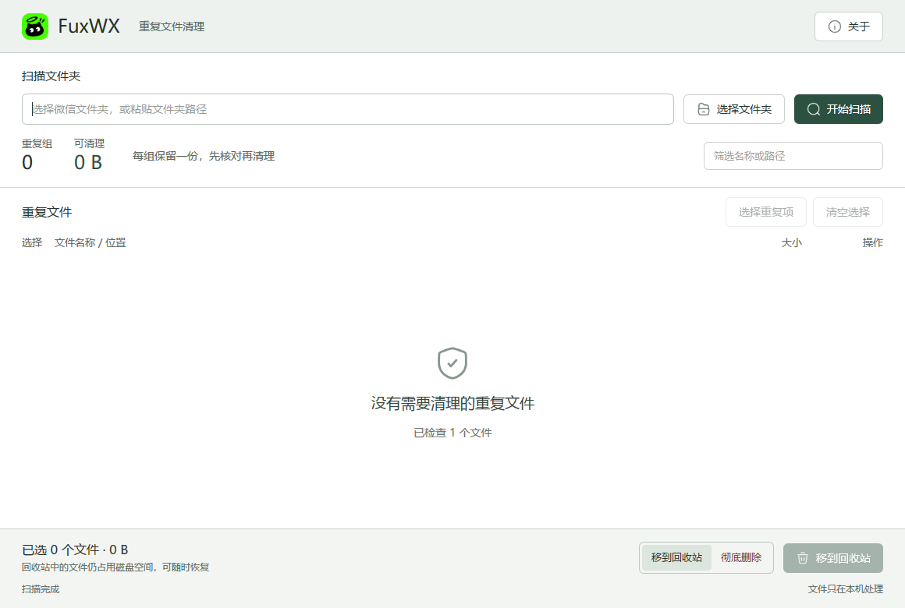

# FuxWX

找出微信文件夹中的重复文件，确认后清理

## 界面预览

## 项目说明

FuxWX 基于 WxCleaner 开发，面向 Windows 用户。扫描指定文件夹后，可以查看内容相同的文件、选择要保留的副本，再确认清理。文件只在本机处理。

## 可以用来做什么

- 扫描指定文件夹，按完整内容找出重复文件
- 对照每组文件的位置和大小，选择需要保留的文件
- 将重复文件移到回收站，或明确选择彻底删除
- 查看清理进度、停止任务并核对失败项目
- 按名称或路径筛选结果，预览图片或打开文件位置

## 下载与上手

当前版本为 0.1.0，处于本地测试阶段，尚未上传正式安装包。后续公开版本请查看[发布页面](https://github.com/OUBIGFA/FuxWX/releases)。

1. 打开 FuxWX，点击“选择文件夹”
2. 选择要检查的微信文件夹，点击“开始扫描”
3. 核对结果，点击“选择重复项”，每组默认保留路径较短的一份
4. 选择删除方式，核对数量和大小后确认

## 按需使用

默认清理方式为移到回收站。点击文件名称查看详情；点击“保留这份”可以更换同组保留的文件。任务进行时可以点击“停止任务”，已完成的操作不会撤销。

## 注意

- 支持 Windows 10 1809 及更新版本、Windows 11，当前测试包为 x64
- 彻底删除不经过回收站，无法从回收站恢复；重要文件请先备份
- 回收站内的文件仍占用磁盘空间，清空回收站后才释放空间
- 扫描后已变更或无法访问的文件会保留并报告；回收失败不会改为彻底删除
- 图片预览上限为 16 MB，其他文件可以打开其所在位置查看

## 来源与许可

基于 [WxCleaner](https://github.com/yqxie1991/WxCleaner) 二次开发，保留原作者版权，项目采用 [MIT 许可](LICENSE)。界面基于 [nsh](https://github.com/longbridge/nsh)。图标采用 [Solar Linear](https://github.com/saoudi-h/solar-icons)，由 [480 Design](https://www.figma.com/community/file/1166831539721848736) 设计，按 CC BY 4.0 署名使用。

详细来源见[第三方记录](third_party/README.md)。
